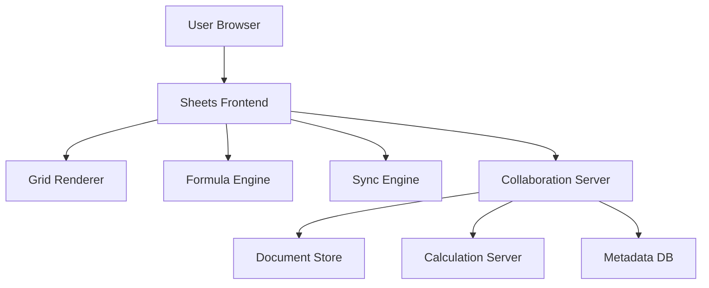
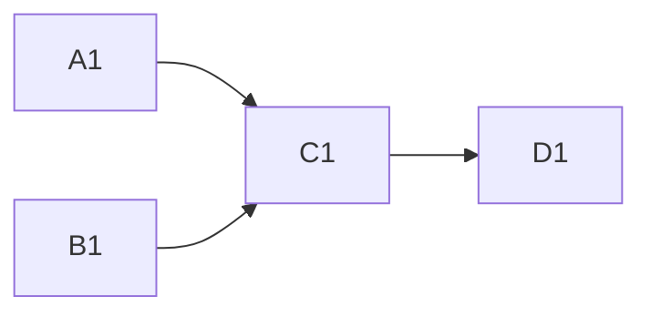
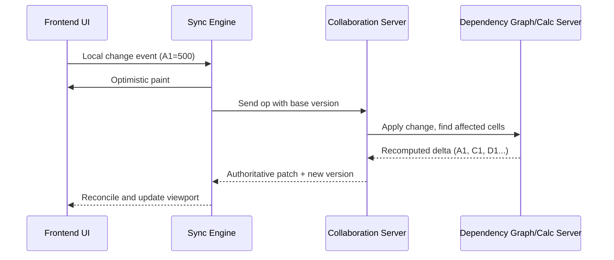

# Google Sheets Frontend + Backend System Design (HLD)

## Scope
This design focuses on end-to-end Google Sheets style architecture with emphasis on two frontend scale concepts:

1. Millions of cells -> virtualized rendering
2. Slow scrolling -> windowing + recycling

And how these interact with formula computation, dependency graph execution, backend storage, and real-time collaboration.

---

## 1) High-Level Architecture



### Responsibilities
- Sheets Frontend: rendering, edit interactions, local optimistic state
- Grid Renderer: virtual grid, windowing, DOM recycling
- Formula Engine (client): parse/validate formulas, lightweight local evaluation for fast UX
- Sync Engine: operation batching, version tracking, reconnect and replay
- Collaboration Server: authoritative merge + fanout to active clients
- Calculation Server: dependency graph recomputation at scale
- Document Store: workbook/sheet/cell persistence
- Metadata DB: sharing, ACLs, ownership, history pointers, document metadata

---

## 2) Spreadsheet Grid Rendering
Large sheet dimensions (for example):

- Rows: 1,048,576
- Columns: 18,278
- Logical cells: billions possible

Rendering every cell node is not feasible due to DOM, style, layout, and memory overhead.

### Core Approach
Only cells in or near the viewport are mounted.

If the viewport displays rows 100..130 and columns C..H, then mounted DOM is limited to that region (plus buffer), not the full sheet.

### Visible Range Computation
For fixed row/column sizes:

- `rowStart = floor(scrollTop / rowHeight)`
- `rowVisible = ceil(viewportHeight / rowHeight)`
- `rowEnd = rowStart + rowVisible - 1`
- `colStart = floor(scrollLeft / colWidth)`
- `colVisible = ceil(viewportWidth / colWidth)`
- `colEnd = colStart + colVisible - 1`

---

## 3) Windowing + Recycling (Smooth Scroll)

### Windowing (Overscan)
Do not render exactly visible range only. Render a moving buffered window:

- Visible rows: 100..130
- Window rows: 80..150

Benefits:

- Fewer rerenders for small scroll steps
- Lower scroll-time churn
- Better frame consistency

Formula:

- `windowStart = max(0, start - overscan)`
- `windowEnd = min(total - 1, end + overscan)`

Apply for both rows and columns.

### Recycling
Keep a fixed pool of cell DOM nodes and remap indices as the window moves.

Before:

- node1 -> row 100
- node2 -> row 101

After fast scroll:

- node1 -> row 500
- node2 -> row 501

Same nodes, new bindings and position transforms.

---

## 4) Cell Data Model

```json
{
  "id": "A1",
  "value": 10,
  "formula": "=B1+C1",
  "type": "number",
  "format": "general",
  "version": 42
}
```

### Notes
- `value`: computed/display value
- `formula`: user expression if cell is formula-driven
- `version`: monotonic per-cell or per-document versioning for sync/reconciliation

---

## 5) Formula Engine and AST
When a user enters `=A1+B1`:

1. Parse expression
2. Build AST
3. Resolve cell references
4. Evaluate with dependency graph context

AST example:

```text
    +
   / \
 A1   B1
```

Output:

- If A1=10, B1=20 -> result 30

Client can do quick local evaluation for responsiveness; server performs authoritative recomputation.

---

## 6) Dependency Graph and Incremental Recalculation
Represent formulas as a directed dependency graph.

Example:

- C1 depends on A1 and B1
- D1 depends on C1



If A1 changes, recompute only impacted descendants in topological order:

- A1 changed
- Recompute C1
- Recompute D1

This avoids full-sheet recalculation and keeps update latency low.

---

## 7) Cell Update Handling Flow
When user edits A1=500:



Only changed cells are transmitted (delta updates), not the whole sheet.

---

## 8) Large Dataset Handling

### A) Lazy Loading
- Load initial viewport chunks first
- Fetch additional chunks as user scrolls

### B) Chunk-Based Storage
Store ranges in blocks (page-like segments), for example:

- chunk1: A1:Z1000
- chunk2: A1001:Z2000

### C) Columnar Optimization (for analytical workloads)
For some query-heavy operations, column-oriented representation improves scan and aggregation performance.

Use hybrid storage strategy:

- Row/cell-oriented for transactional edits
- Columnar paths for heavy analytical operations

---

## 9) Collaboration and Conflict Resolution
Multiple users may concurrently edit the same region.

Core concepts:

- Versioned operations (document revision numbers)
- Server-side ordering and conflict handling
- Broadcast of merged/accepted operations to subscribers

Conflict handling models:

- Operational Transformation (OT)
- CRDT-based approaches

Goal: eventual convergence with low perceived latency.

---

## 10) Backend Storage Model

### Logical Hierarchy
- Workbook
- Sheet
- Cell

### Suggested Persistence Split
- Metadata DB (SQL): owner, ACL, sharing settings, sheet metadata, document lifecycle
- Cell State Store (distributed KV/document store):
  - key: `spreadsheetId:sheetId:cellId`
  - value: formula, computed value, format, version
- Optional append log for history and replay

---

## 11) Complete End-to-End Example
User types A1=50.

1. Frontend captures keyboard input
2. Grid renderer updates visible cell optimistically
3. Formula/dependency engine identifies affected cells
4. Sync sends operation to collaboration server
5. Server applies, recalculates impacted graph portion
6. Server publishes delta patch
7. Other clients receive and update their own virtual windows

---

## 12) Interview Summary

| Problem | Primary Solution |
|---|---|
| Millions of cells | Virtualized rendering |
| Slow scrolling | Windowing + recycling |
| Formula evaluation | Formula parser + AST engine |
| Dependent formulas | Dependency graph |
| Fast updates | Incremental recomputation + deltas |
| Huge datasets | Lazy loading + chunked storage |
| Multi-user editing | OT/CRDT style sync |

### Final Mental Model
Google Sheets is not just a table renderer.

It is a reactive dependency graph execution system with a virtualized, recycled UI layer and a collaborative versioned backend.
